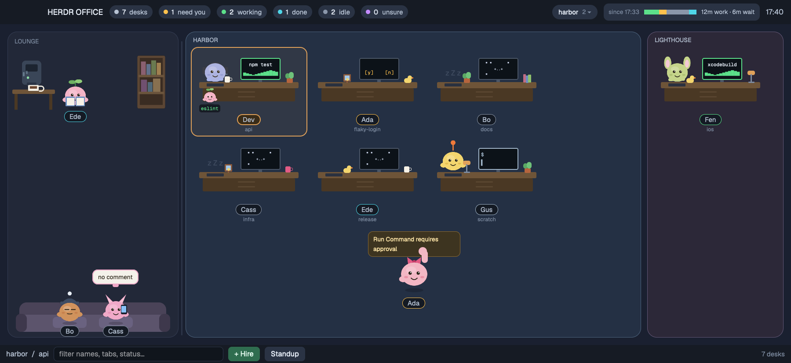
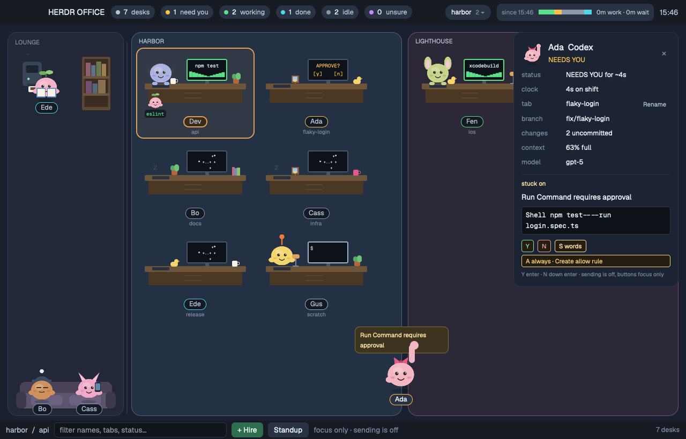

# Herdr Office

[](https://github.com/michaellandi/herdr-office-layout/actions/workflows/check.yml)

A [Herdr](https://herdr.dev) layout that draws your agents as blob people in one open-plan office. Working agents sit behind their desk and type. Idle and finished ones go to the lounge, where they nap, drink coffee, read, check their phone and make small talk. Someone who needs you walks to the front of the room, raises a hand and says what they are stuck on. Helpers an agent starts with `hc run` stand in front of its desk. Click anyone for their card.

This is the native GUI version of the [herdr-office](https://github.com/michaellandi/herdr-office) TUI plugin. The floor is a Herdr mod (QuickJS + GPUI), not a terminal pane and not a web view.





Both screenshots are the [demo floor](#demo-floor): made-up agents, folders and questions, taken in a separate Herdr home so no real terminal is in them. `preview.png` (the image herdr.dev/layouts shows) is the same floor shot.

Prefer the terminal? [herdr-office](https://github.com/michaellandi/herdr-office) is the original: the same office as a Herdr TUI plugin, drawn in a pane with `herdr plugin install michaellandi/herdr-office`.

## Install

### 1. Install Herdr

This is a layout for the **Herdr desktop app**. Download it from [herdr.dev/download](https://herdr.dev/download/) (macOS, Linux and Windows) and open it once. The first start creates the app home, `~/.config/herdr-app`, and puts the `herdr-app` command in `~/.local/bin` (add that to your `PATH` if `herdr-app --help` is not found). herdr-core, which runs the terminals, comes with it.

The terminal app (`herdr`, from [herdr.dev/tui](https://herdr.dev/tui/)) is a separate program; for that one, use the [herdr-office](https://github.com/michaellandi/herdr-office) plugin instead.

### 2. Add the office

Copy the layouts and both mods into the Herdr app home (`~/.config/herdr-app`, or `$HERDR_APP_HOME` if that is set).

```sh
git clone https://github.com/michaellandi/herdr-office-layout.git
cd herdr-office-layout
home="${HERDR_APP_HOME:-$HOME/.config/herdr-app}"
mkdir -p "$home/layouts" "$home/mods"
cp layouts/office.json layouts/office.svg "$home/layouts/"
cp -R mods/office mods/office-peek "$home/mods/"
herdr-app check "$home/mods/office"
herdr-app check "$home/mods/office-peek"
herdr-app do layout.switch '{"name":"office"}'
```

Switch back with Ctrl+Shift+L, or `herdr-app do layout.switch '{"name":"main"}'`. Deleting the two layout files and the two mod folders removes it. Herdr's own layouts and mods are not modified.

### Optional: start new spaces and tabs in one folder

By default a new space or tab starts in the folder of the terminal you have selected, else your home folder. To always start somewhere else, bind the new-space and new-tab keys with a `folder` in `~/.config/herdr-app/keys.json` (replace the existing `cmd-n` / `cmd-t` entries under `"global"`; on Linux and Windows use the keys you have there). The app applies it at once:

```json
"cmd-n": { "command": "space.new", "args": { "folder": "/Users/you/workspace" } },
"cmd-t": { "command": "tab.new", "args": { "folder": "/Users/you/workspace" } }
```

Use an absolute path that exists: `folder` does not expand `~`, and a missing folder makes the key fail with an error instead of opening the tab.

Once you edit `keys.json` it is yours: Herdr stops updating it, so new default shortcuts from later releases have to be added by hand. Keep a copy of the file before editing. The menu bar shows only plain string bindings, so these keys no longer appear next to New Space and New Tab there, but they still work. The tab bar's **+** and **+ Hire** keep their own folders.

The desktop app does not read the terminal app's `~/.config/herdr/config.toml`. If you use both, set the same folder there for `herdr`:

```toml
[terminal]
new_cwd = "~/workspace"
```

`herdr config check` validates it; `herdr server reload-config` applies it to a running session.

### About office-peek

`mods/office-peek` is a clone of Herdr's `peek` mod (made with `mod.clone`) whose button reads "Promote to desk" instead of "keep". The office opens it when you peek at a helper.

## The floor

- **Desks.** Every agent keeps a home desk on a rug tinted by its space; the rug label is the space name. A working agent sits behind the desk with hands on the keyboard. The monitor shows what it is running (`npm test`, `git rebase`) with a moving bar, scrolling code lines when the command is not known, `APPROVE?` while it needs you, and a starfield screensaver while it is idle. A plain terminal with no agent in it gets a desk too, with a `$` prompt on the monitor. Each desk has two props (mug, plant, frame, rubber duck, lamp, books) that stay with it. Drag a desk (or the person at it) onto another seat in the same space to reorder; the rest shift over and the order is remembered. It is the office's own order: Herdr's tab order does not change.
- **Name tags.** The name sits in a tag whose border is the status color, with the tab name under it. The desk whose terminal has the keyboard is framed in Herdr's focus color; other desks on screen in a split tab get a faint outline.
- **Lounge.** Idle and done agents sit on the couch. Seats stick: nobody shuffles when someone leaves. Each lounger naps, drinks coffee, reads or checks their phone, changing every few minutes, and pairs on the couch trade a few lines in speech bubbles now and then. Drag the lounge's right edge to resize it; the width is remembered.
- **Needs you.** A blocked agent stands at the front of the room with a waving arm and a bubble with their question.
- **Helpers.** Terminals another terminal started with `hc run` (sub-agents) stand in front of their parent's desk, up to three, each labelled with the name it was started with (`hc run --name lint`), else its command. Busy ones bob, a blocked one shows `!`, idle ones doze. More than three show as `+N`.

Moves use GPUI `.transition`; bobbing, typing, steam and screens use `.loop` and `.frames`. Nothing animates by redrawing on a fast timer.

## Cards

Click a person or a desk to open their card; click empty floor (or anywhere outside the card) to close it. The card shows the person's name (with **Rename**: Herdr's own prompt, filled in with the current name, stored as the pane's name, so the floor, the card, the pane header and every other client and layout use it; an empty name gives the cast name back, and the cast name still matches in the filter), status and for how long, time on shift, tab (with **Rename**), branch, uncommitted counts, context percent and model when the status line has one.

For a blocked agent it adds what they are stuck on, the tool call it is about (for example `Shell npm test -- --run login.spec.ts`), and buttons:

| Key | Button | Does |
| --- | --- | --- |
| Y | Y | approve |
| N | N | deny |
| S | S words | answer in words (a text field, then **Send words**) |
| Shift-A | A always | "yes, and don't ask again", only when the menu offers it; press twice to confirm |
| Esc | × | close the card |

Clicking someone who needs you keeps the keyboard on the card, so a bare Y or N answers them. The line under the buttons says exactly which keys each one sends.

A card lists its agent's helpers (name, command, status, how long). Click one to drill into its own card (← goes back), with **Peek at terminal**, **Promote to desk** (gives it its own tab, and so its own desk) and **End** (stops and removes it, after a confirm).

## Header and rail

- The header counts desks, need you, working, done, idle and unsure; click a count to filter the floor. The space button opens a list of spaces with their shortcuts. The punch-clock chip is how today has been spent (work, waiting, idle, done) since the layout was shown.
- The rail has the filter (name, program, tab, space, status, branch or directory name), **+ Hire**, **Standup**, the current notice, and the desk count.
- **+ Hire** starts a new tab: a plain **Terminal** (so you pick the directory), or any installed agent. Optional fields name the tab and the agent (the agent name is set on its pane once the tab appears, as the card's Rename would). The agent list is cached, so the dialog opens at once.
- The boundary between the floor and the panes below can be dragged.

## Answering for you

**Off by default.** The floor block in `layouts/office.json` sets `"send": false`. While it is false, the answer buttons and keys only focus the agent. Set it to `true` and save; Herdr reloads the mod.

The keys are read off the agent's screen the way herdr-office reads them (`mods/office/ask.js`, ported from its `src/summary.mjs`, with its tests):

| Prompt shape | Y sends | N sends |
| --- | --- | --- |
| `(y/n)` / `[y/n]` | `y` | `n` |
| numbered menu, 1 is a yes | `1` | `esc` |
| cursor menu (`❯ Yes` / `No`) | downs or ups to the yes row, then `enter` | the same walk to the no row |
| anything else | `enter` | `esc` |

A cursor-menu walk is recomputed off a fresh read right before sending, and nothing is sent if the rows changed. Keys go out through `hc keys`; a written answer through `hc send`. Standup, when sending is on, types the same line into up to 12 idle terminals.

## Helpers and agents

Nothing needs configuring for helpers: the office reads Herdr's own `terminals()` and each one's `parent`. Herdr's agent skill (`hc --skill`) already tells agents to start helpers with `hc run --bg --name <name>`. If your agents open new tabs for side work instead, a line in your agent instructions such as "start helpers with `hc run --bg --name <short-name>`, never a new tab" keeps them at the right desk and labelled.

## Settings

| Prop | Where | Default | Effect |
| --- | --- | --- | --- |
| `send` | floor block, `layouts/office.json` | `false` | `true` lets Y / N / always, the written answer, and standup type into agents |
| `demo` | floor block | `false` | `true` draws a made-up floor (see below) |

Identity, home desks, lounge seats and width, the punch clock and "how long in this status" are kept in the mod's local storage.

## Demo floor

`layouts/office-demo.json` is the office with `"demo": true`: seven made-up agents in two spaces (one blocked, one with a helper, two chatting in the lounge), invented folders, branches and questions. It reads no screen, runs no `git` or `ps`, sends nothing and focuses nothing, so it is safe to screenshot. Your real terminals still show in the panes under the floor, so crop to the floor.

```sh
cp layouts/office-demo.json layouts/office-demo.svg "$home/layouts/"
herdr-app do layout.switch '{"name":"office-demo"}'
```

## Privacy

Same rules as herdr-office:

- Git is `git status --porcelain=v1` with `--no-optional-locks`, `core.fsmonitor=false` and `core.quotePath=true`, run on the space's machine. The floor shows counts only; paths from git are never drawn.
- The context gauge keeps a percent and a model name from a fixed list (`opus`, `sonnet`, `gpt`, `codex`, …). The status line itself is not stored or drawn.
- What a desk or helper is running comes from one `ps` per pass, walked below that agent only, and only a program name plus one short sub-command (bare words of 16 characters or fewer) ever reaches the screen. Arguments, which is where tokens and paths live, never do. Wrappers, shells, MCP servers and telemetry are filtered out.
- A blocked agent's question, the tool call it is about and its last few lines are drawn in its bubble and card, as in herdr-office. Nothing else off a screen is drawn or stored.
- Directory labels are the last path segment.

## What this version does not do

- No shepherd mode, single-cubicle zoom, news slabs or escalation toasts (Herdr already toasts when an agent needs you).
- "Unsure" is only for a status outside working / blocked / done / idle, which today's app does not report.
- Looks repeat after seven agents; the tab name, or a name you give them (card **Rename**, or the Hire dialog), tells them apart.
- Tabs an agent opens with `tab.new` are separate desks with no link back to it. Only `hc run` helpers are linked.

## Check without the app

The `scripts/` checks exercise the ported logic without importing `herdr`: counters, gauge, notices, punch clock, seating, the send gate, the approval reader (the herdr-office tests), the process allowlist, lounge seats, helpers and looks.

```sh
node --experimental-default-type=module scripts/check-logic.js
node --experimental-default-type=module scripts/check-process.js
node --test scripts/check-ask.js
```

## Credits

The office, the status rules, the punch clock, the dirt counts, the context gauge, the notices, the approval reader and the process detection are ported from [herdr-office](https://github.com/michaellandi/herdr-office), which is MIT like this layout. `mods/office-peek` is a clone of Herdr's own `peek` mod.

The blob cast (bow and mug, beanie, cat ears and glasses, headphones, sprout, lop ears, antenna) is new art for the GUI. Body color is identity; status is on the name tag.

Built against the layout guide in [herdr-app](https://github.com/herdrdev/herdr-app) and the [pasture example](https://github.com/herdrdev/herdr-layout-examples/tree/main/pasture).
