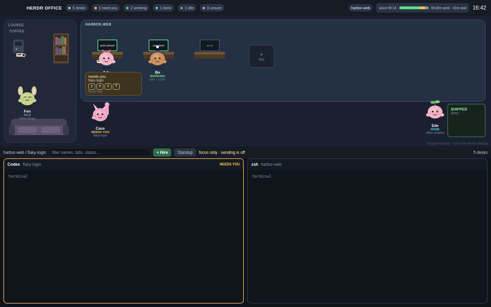

# Herdr Office

Your agents as blob people in one open-plan office, above the live tab. Working people sit at a home desk, idle people go to the lounge, done people stand at the shipped board, and someone who needs you walks to the front with a hand up. Click a person and their terminal is focused below.

This file is the brief: enough to build the office from an empty folder. The files next to it are one build of it. `preview.png` is a design mockup of that window, not a capture of a running Herdr.

## What you see

Four bands, top to bottom, filling the window (no title bar). Dark ink UI, Geist. Floor `#1a2030`, header and rail `#161b24`, cards `#10141b`. Status colors, used only on labels and rings: working `#5ce08a`, needs you `#ffc14d`, done `#4fd6e8`, idle `#8b97aa`, unsure `#c48bff`.

1. **Header**, 46px, `window_drag`. On macOS the content starts 78px in, under the traffic lights at `[12, 16]`. "HERDR OFFICE", then count chips (desks, need you, working, done, idle, unsure), space chips, a punch-clock chip (`since HH:MM`, a stacked bar, `NhMM work · Nm wait`), and the clock. Where the system draws no window buttons, the header draws minimize, maximize and close.
2. **Floor**, about half the window (`weight: 0.9`). One room.
   - Left, a lounge card (`#222838`, about 17% of the width, at least 176px): coffee machine, bookshelf, couch.
   - The rest is rugs, one per space that has a visible agent. Two or more spaces get muted tints in floor order (slate, heather, teal, rose, olive, sand). One space stays the plain rug `#222a38`. The rug label is the space name.
   - Each agent has a home desk on their space's rug: a monitor and a wooden desk. An open seat at the end of the rug says "+ hire".
   - Bottom right of the room: a green "SHIPPED" board.
   - A detail card (268px) sits at the top right of the floor while someone is hovered or was clicked.
3. **Rail**, 34px. `space / tab`, a filter field ("filter names, tabs, status…"), **+ Hire**, **Standup**, the current notice or "focus only · sending is off", and the desk count.
4. **The live tab**, the rest. Panes are cards with a 10px gap, 10px radius, framed even when alone. Border `#2c3548`. Focus border `#e0a15a`, 2px. Header 32px, always visible, background `#141a22`: program icon and name, branch, directory name, `+N` uncommitted, context percent, status label. Hover adds split, zoom and close.

Body colors are the cast, never the status colors:

| Name | Body | Topper |
| --- | --- | --- |
| Ada | `#F3B7C4` | bow and mug |
| Bo | `#D0925C` | beanie |
| Cass | `#F0A9C8` | cat ears and glasses |
| Dev | `#A9B4EA` | headphones |
| Ede | `#F4B3C6` | sprout |
| Fen | `#C5D48A` | lop ears |
| Gus | `#F3D56E` | antenna |

## How it behaves

Every agent has one home desk. The desk number sticks for that terminal in that space. The blob is chosen by a hash of the terminal address, walking forward if that look is taken, and then remembered. Status does not change who they are.

| Status | Where | Pose | Extra |
| --- | --- | --- | --- |
| working | home desk | sitting | green ring, tab name on the monitor, a small bob |
| blocked (needs you) | front of the room | hand raised | amber ring, bounce, a bubble: "needs you", the tab name, buttons y n s Y |
| idle | coffee, then along the couch | dozing | "z" fading, monitor says "away" |
| done | shipped board | sitting | cyan ring |
| anything else | bookshelf | dozing | label UNSURE. The app's four statuses never land here |

- Hovering a blob pins the detail card (status and duration, on-shift time, tab, space, directory name, branch, uncommitted words, context words, model). It does not move the keyboard.
- Clicking a blob or their desk runs `agent.focus` with that terminal.
- Clicking an open seat, or **+ Hire**, opens a dialog of `knownAgents()`. An installed agent starts with `tab.new` (`argv` is that agent's `run`, in the seat's space and folder).
- Count chips toggle a status filter. The rail field filters name, program, tab, space, status, branch and directory name. `setAgentOrder` follows whoever is still on the floor.
- A notice line (collision, head ≥ 90%, same question, idle with uncommitted files) focuses the agent it names. Clicking it advances to the next notice.
- **Standup** lists idle agents. It types only when sending is on.
- Moves animate with `.transition("left")` and `.transition("top")` over 900ms, ease-in-out. Flourishes are `.loop` (bob, bounce, steam, "z"). A 2s timer updates the punch clock. Git and `hc read` run about every 30s.
- `send` is a prop on the floor block, default `false`. Off: y / n / s / Y focus the agent and the bubble says "focus only". On: y, n and Y are `hc(["send", address, "y"|"n"|"Y"])`. s opens a field; submit sends the text plus a newline. Standup sends that same line to at most 12 idle terminals. This is not the TUI's menu walker.

## Built from

- **The layout** (`layouts/office.json`): a root `column`, `"titlebar": "none"`, theme `ink`, its own `colors`, then four children. Header and rail are the mod with `props.role` of `header` and `rail`. The floor is the mod with `props.send` `false` and no role. The work block is `content: { tab: "active", pane: { … } }` and `pane.header` is the mod with `props.role` `pane`. `layouts/office.svg` is the settings thumbnail.
- **One mod** (`mods/office/`): `main.js` is the view. `draw.js` paints the five roles (`floor`, `header`, `rail`, `pane`, plus overlay roles `hire` and `standup`). Ported, with the node and the cell-grid painter removed: `dirt.js`, `head.js`, `ask.js`, `notices.js`, `punch.js`, `text.js`, `rooms.js`. New: `identity.js`, `seats.js`, `people.js`, `place.js`, `filter.js`, `send.js`, `theme.js`.
- **Data:** `agents()`, `spaces()`, `panes()`, `props()`, `shared` / `setShared`, `window()`, `knownAgents()`.
- **Commands:** `agent.focus`, `space.select`, `tab.new`, `pane.focus`, `pane.split`, `pane.zoom`, `pane.close`, `window.minimize`, `window.maximize`, `window.close`, `setAgentOrder`, `setWindowTitle`, `setBadge`, `openOverlay` / `closeOverlay`.
- **Programs:** `exec("git", dirtArgs(cwd), { cwd, on: space.machine, timeout: 4000 })`. Args include `--no-optional-locks`, `-c core.fsmonitor=false`, `-c core.quotePath=true`, `-C`, `status --porcelain=v1 --untracked-files=normal`. `hc(["read", address, "--lines", "24"])` for the gauge. `hc(["send", address, text])` only when `send` is true.
- **Art:** `mods/office/<cast>-<sit|hand|doze>.svg`, plus `coffee.svg`, `couch.svg`, `shelf.svg`. Full color via `image()`, not `svg()`.

## Watch out

- Do not draw `cwd`, git porcelain, or `hc read` output. Counts, a model from the fixed list, a hash, and the last path segment are the whole of what leaves those calls.
- `checking()` returns before timers, `exec`, `hc`, and `setShared`. `init` still builds the reply field, because `herdr-app check` renders the view.
- Asset paths are `mods/office/…`. Renaming the folder means renaming those paths and the `mod` names in the layout.
- Homes and looks are remembered in `localStorage` (`office.seats.v1`, `office.cast.v1`). The punch clock and status durations (`office.punch.v1`, `office.since.v1`) reset when the local day changes. Storage is per mod props, so only the floor copy (the one with `send`) writes it and republishes through `shared`.
- y / n / Y do not press Enter and do not walk a menu. Leave `send` false until that has been watched on a real agent.
- Pixel layout. A narrow window scrolls the floor. Ten-plus agents on one rug wrap to another row and the room grows downward.
- The layout brings its own colors. Drop `theme` and `colors` to follow the person's theme. The mod's floor colors are still the hexes above.

## Done when

- Every agent is a blob with a stable name and topper, a home desk, and a place that matches the table above.
- Clicking a blob focuses that agent, the rail names their space and tab, and the pane header shows their status.
- An empty seat hires an installed agent into that space.
- With `send` left false, y / n / s / Y do not call `hc`.
- Dirt on a card is a count, the context row is a percent and maybe a model, and neither row contains a path or a line from the terminal.
- `herdr-app check mods/office` passes, and switching to another layout and back works.
